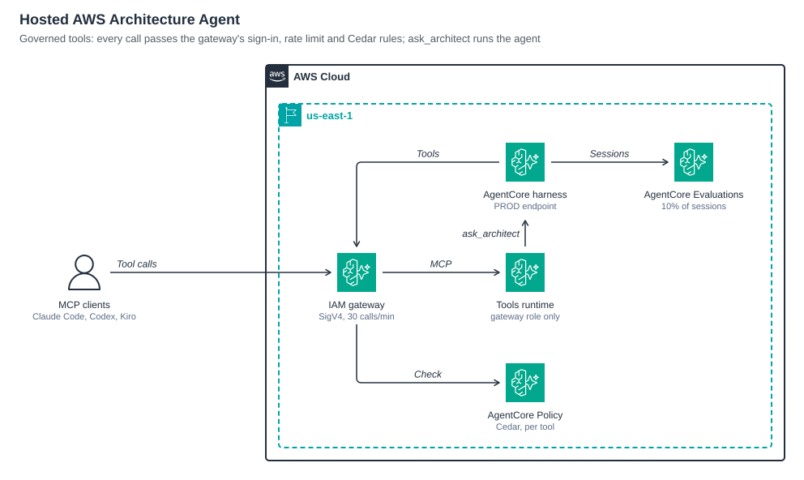
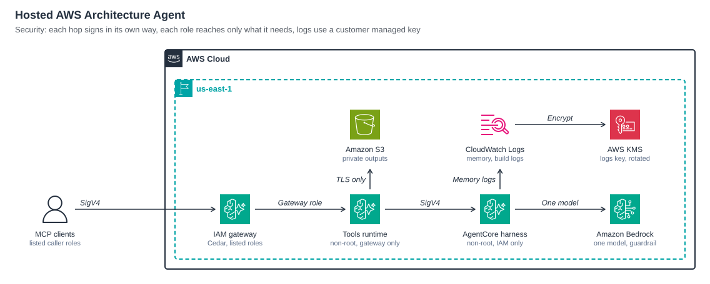
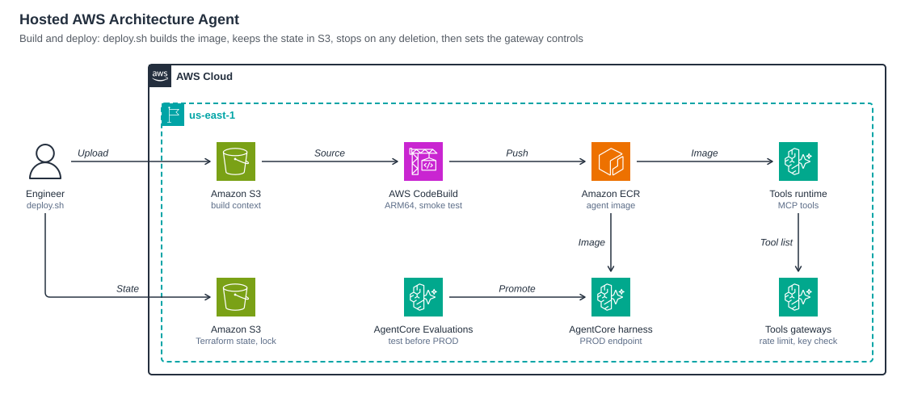
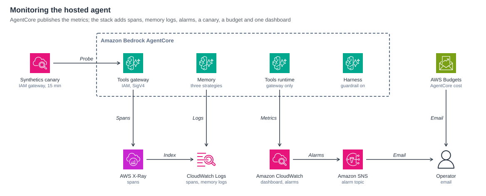

# Deploy a skills-based agent with governed MCP tools on Amazon Bedrock AgentCore by using Terraform

This sample hosts an AI agent on the [Amazon Bedrock AgentCore](https://docs.aws.amazon.com/bedrock-agentcore/latest/devguide/what-is-bedrock-agentcore.html) harness, deployed entirely with Terraform, and serves it over the Model Context Protocol (MCP). The agent's prompt and [agent skills](https://docs.aws.amazon.com/bedrock-agentcore/latest/devguide/harness-skills.html) are baked into a custom container image, and its tools run as an MCP server on AgentCore Runtime behind AgentCore Gateway, where a default-deny Cedar policy allows only the tools and callers you list. MCP clients such as Claude Code, Codex and Kiro call the tools directly, or hand a whole request to the hosted agent with one tool, `ask_architect`. AgentCore Memory keeps session context, AgentCore Evaluations scores a sample of sessions, Amazon CloudWatch watches the stack, and an AWS Agent Registry entry makes the tools discoverable.

The worked example is an **AWS architecture agent**: it draws AWS architecture diagrams with the official AWS Architecture Icons and checks their layout, writes AWS design documents (HLD, LLD, ADR, runbook, Well-Architected review) as HTML and Word, and checks AWS facts against the AWS documentation. To host a different agent, swap the prompt, the skills and the MCP server; see [Host your own agent](#host-your-own-agent).

> This is sample code, for non-production usage. You should work with your security and legal teams to meet your organizational security, regulatory and compliance requirements before deployment. The agent runs model-generated shell commands inside an isolated session sandbox; read [SECURITY.md](SECURITY.md) before you deploy.

## Architecture


1. An MCP client signs each call with the caller's AWS credentials (SigV4) through the [MCP Proxy for AWS](https://github.com/aws/mcp-proxy-for-aws) and reaches the AgentCore Gateway. The gateway's default-deny Cedar policy permits only the listed tools, and only for the roles in `tool_caller_role_names`.
2. The gateway forwards to the MCP server in `mcp-server/`, which runs on AgentCore Runtime from the same image. A resource policy lets only the gateway role invoke it.
3. The tools render diagrams, run the two layout checks, build HTML and Word documents and lint them. Finished files are uploaded to Amazon S3 and returned as presigned links.
4. `ask_architect` runs one turn of the hosted agent: the AgentCore harness, a managed agent loop with the prompt in `agents/aws-architect.md` plus `hosted/prompt-hosted.md`, a Claude model on Amazon Bedrock (with an optional guardrail), managed AgentCore Memory, and the same skills baked into its session image. It plans, renders, checks and reviews the figures itself and returns its answer with a `session_id` to continue.
5. The harness reads AWS documentation through the [AWS Knowledge MCP Server](https://awslabs.github.io/mcp/servers/aws-knowledge-mcp-server) and calls the tools through the same gateway; it is never allowed to call `ask_architect` itself.



6. `hosted/scripts/gateway-controls.sh`, which `deploy.sh` runs after each apply, refreshes the gateway's tool list and allows each caller 30 tool calls a minute.
7. Traces go to Amazon CloudWatch (Transaction Search), AgentCore Evaluations scores a sample of sessions, and `promote.sh` moves a version to a pinned `PROD` endpoint only after it passes an evaluation.





8. `hosted/scripts/deploy.sh --build` packages the source; AWS CodeBuild builds the linux/arm64 image (AgentCore runs arm64 images only), renders a test figure inside it as the image's unprivileged user, and pushes it to Amazon ECR. Terraform, with its state in an S3 bucket, then points the harness and the tools runtime at the new tag.



9. CloudWatch alarms on errors, throttles and slow tool calls email you through Amazon SNS, a CloudWatch Synthetics canary calls the tools through the gateway every 15 minutes, and an AWS Budgets budget watches AgentCore cost.

## Prerequisites

- An AWS account and a Region where the [AgentCore harness](https://docs.aws.amazon.com/bedrock-agentcore/latest/devguide/harness.html) is available (the default is `us-east-1`).
- Access to an Anthropic Claude model in Amazon Bedrock. The default inference profile is `us.anthropic.claude-sonnet-5-5`; set `model_id` for another.
- Terraform 1.9 or later (AWS provider 6.67 or later), AWS CLI v2, Python 3 with `boto3`, Node.js 22.18 or later, `zip`, and [uv](https://docs.astral.sh/uv/) for the MCP Proxy for AWS.
- Credentials for an IAM principal that can create the resources listed in [SECURITY.md](SECURITY.md).

## Deploy

```bash
hosted/scripts/create-state-bucket.sh          # S3 bucket for the Terraform state (versioned, encrypted, locked); writes backend.tf
cp hosted/terraform/terraform.tfvars.example hosted/terraform/terraform.tfvars   # then set your inputs
terraform -chdir=hosted/terraform init
terraform -chdir=hosted/terraform apply        # buckets, ECR, CodeBuild, roles, policy engine, evaluator, registry
hosted/scripts/deploy.sh --build               # image (about 5 minutes on ARM CodeBuild), harness, tools runtime, gateway, controls
hosted/scripts/promote.sh                      # test turn on DEFAULT, evaluate it, point PROD at it (ask_architect calls PROD)
hosted/scripts/register-tools.sh               # optional: registry record for the gateway
```

`deploy.sh` reads every input from `terraform.tfvars`, plans, refuses a plan that deletes or replaces anything unless given `--allow-delete`, and asks before it applies. Variables are in `hosted/terraform/variables.tf`. `enable_transaction_search` changes a Region-wide X-Ray setting; set it to `false` if your account already manages that.

## Use

Add the name of the IAM role you work with (`aws sts get-caller-identity`) to `tool_caller_role_names` in `terraform.tfvars` and redeploy. Then add the gateway to your MCP client:

```bash
URL="$(terraform -chdir=hosted/terraform output -raw tools_gateway_url)"
claude mcp add-json aws-architecture "{\"type\":\"stdio\",\"command\":\"uvx\",\"args\":[\"mcp-proxy-for-aws-cli@1.7.0\",\"$URL\",\"--service\",\"bedrock-agentcore\",\"--region\",\"us-east-1\"]}"
codex mcp add aws-architecture uvx mcp-proxy-for-aws-cli@1.7.0 "$URL" --service bedrock-agentcore --region us-east-1
```

Ready configuration files for each client are in [examples/mcp-clients](examples/mcp-clients/README.md). Ask your client to draw something ("Draw a serverless REST API: Amazon API Gateway, AWS Lambda, Amazon DynamoDB"); [examples/requests.md](examples/requests.md) has more to try. It either drives the tools itself, passing file contents in the `*_source` arguments, or calls `ask_architect` to have the hosted agent do the whole job. An `ask_architect` turn takes a few minutes, so raise the client's tool timeout to 15 minutes (Claude Code: `MCP_TOOL_TIMEOUT=900000`; Codex: `tool_timeout_sec = 900`).

Set `enable_jwt_gateway = true` to add a second gateway (`tools_signin_gateway_url`) that accepts access tokens from the stack's Amazon Cognito user pool, so clients connect with a sign-in instead of AWS credentials.

## Operate

| Task | Command |
|---|---|
| Release a new version | `hosted/scripts/deploy.sh --build` |
| Promote a tested version to the pinned `PROD` endpoint, or roll back | `hosted/scripts/promote.sh`, `hosted/scripts/promote.sh --version <n> --skip-eval` |
| Score one session on demand (also a CI gate) | `python3 hosted/scripts/evaluate.py --session <id>` |
| Tool usage, failures and user feedback | `python3 hosted/scripts/usage.py --days 7` |
| Dashboard | `terraform -chdir=hosted/terraform output -raw dashboard_url` |

Details are in [hosted/README.md](hosted/README.md).

## Host your own agent

The stack is not specific to the architecture agent. Everything agent-specific is an input:

| What | Where | Default |
|---|---|---|
| System prompt | `agent_prompt_file`, `extra_prompt_files` | `agents/aws-architect.md`, `hosted/prompt-hosted.md` |
| Skills | `skill_paths` (folders with a `SKILL.md`, inside the image) | the three skills in `skills/` |
| Runtime tools | `hosted/container/Dockerfile` (what the image installs) | Node.js, Python, pandoc, the skills' packages |
| MCP tools | the image's `CMD` serves MCP on `0.0.0.0:8000/mcp`; `tools_target_name`, `tool_names`, `enable_mcp_tools` | `mcp-server/`, target `archtools`, 8 tools plus `ask_architect` |
| Model | `model_id` | `us.anthropic.claude-sonnet-5-5` |

1. Put your skills and MCP server in the image (copy them in `hosted/container/Dockerfile`) and install their dependencies at build time.
2. Write your prompt file, and keep or adapt `hosted/prompt-hosted.md` (where to work, how to publish files with `publish.py`).
3. Set the variables above in `terraform.tfvars` and run `hosted/scripts/deploy.sh --build`. If your agent has no MCP server, set `enable_mcp_tools = false`.

## Cost

You pay for what the stack uses: AgentCore Runtime CPU and memory per session, Gateway calls, Policy authorizations, Memory, Evaluations, Amazon Bedrock model tokens, CodeBuild minutes, CloudWatch alarms, logs and the canary, and S3 and ECR storage. Model tokens are most of the cost of a session. See [Amazon Bedrock AgentCore pricing](https://aws.amazon.com/bedrock/agentcore/pricing/) and [Amazon Bedrock pricing](https://aws.amazon.com/bedrock/pricing/). Idle sessions stop after 10 minutes, and `monthly_budget_usd` sets a budget alert.

## Clean up

```bash
terraform -chdir=hosted/terraform destroy -var image_tag="$(terraform -chdir=hosted/terraform output -raw image_tag)"
```

The buckets and the ECR repository are deleted with their contents. Before the destroy, delete any registry record added by `register-tools.sh` (`aws agent-registry-control delete-registry-record`) and the `PROD` harness endpoint `promote.sh` created; afterwards delete any workloads the agent created in the AWS Well-Architected Tool, and the state bucket if you no longer need it.

## Repository layout

| Path | What it holds |
|---|---|
| `agents/aws-architect.md` | The agent prompt |
| `skills/` | `aws-archify` (diagrams, renderer, layout checks), `aws-design-doc` (HTML and Word builders, templates, lint), `aws-docs-lookup` |
| `mcp-server/` | The tools as an MCP server (stdio locally, Streamable HTTP on AgentCore Runtime) |
| `hosted/` | The container image, the Terraform stack, the canary, scripts and figures |
| `examples/` | Example requests, MCP client configurations for Claude Code, Codex and Kiro, two design documents and the diagram gallery |

## Test locally

```bash
bash setup.sh
node mcp-server/test.mjs
```

## Security

See [CONTRIBUTING](CONTRIBUTING.md#security-issue-notifications) for more information, and [SECURITY.md](SECURITY.md) for the controls and production hardening.

## License

This library is licensed under the MIT-0 License. See the [LICENSE](LICENSE) file. The AWS Architecture Icons and other third-party components keep their own terms; see [THIRD_PARTY_LICENSES.md](THIRD_PARTY_LICENSES.md).
