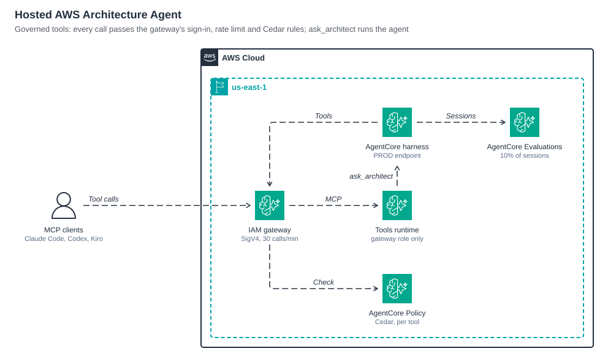
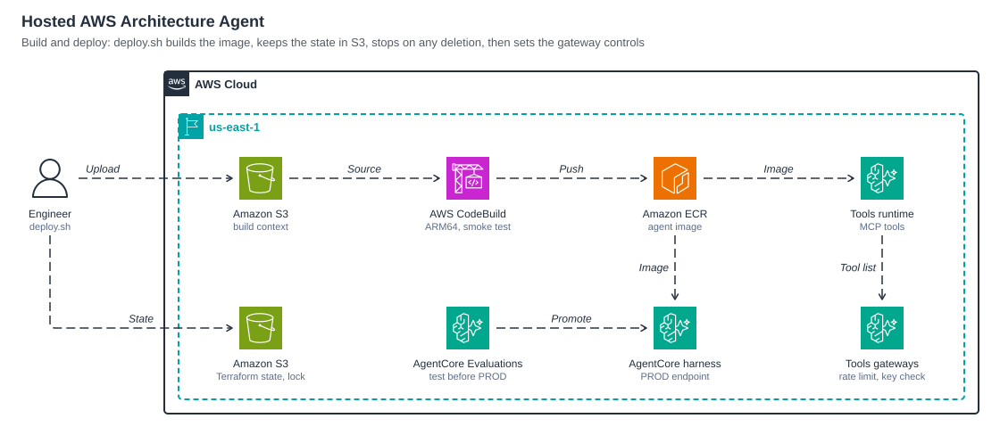

# Hosted AWS Architecture Agent

The same agent and skills, run as a hosted service on Amazon Bedrock AgentCore and deployed with Terraform. Users sign in and ask; nothing is installed on their machine.

## How it works


Every client speaks MCP: Claude Code, Codex, Kiro and the canary through the IAM gateway, Amazon Quick through its own gateway. All of them end at the same tools, and `ask_architect` hands a whole request to the hosted agent.

1. An `ask_architect` call reaches the AgentCore harness from the tools runtime, signed with the runtime's role (SigV4); nothing else is granted `InvokeHarness` apart from the people who run the stack.
2. The harness is the agent: a managed agent loop with the plugin's `aws-architect` prompt plus `prompt-hosted.md`, a Claude model on Amazon Bedrock, and managed memory that keeps context across a session.
3. Each session runs in its own microVM built from this repo's image (`container/Dockerfile`). The three skills are baked in with every package installed, so the agent runs the same scripts as the plugin: the renderer, both layout checks, the HTML and Word builders and the document lint.
4. Finished figures and documents are uploaded to Amazon S3 by `container/publish.py`, which returns presigned download links. A Well-Architected review can also be recorded as a workload in the AWS Well-Architected Tool.



5. The plugin's MCP server runs on AgentCore Runtime (MCP protocol, stateless HTTP) from the same image, behind an AgentCore Gateway with IAM auth. AgentCore Policy checks every tool call with Cedar: only the harness role (and roles in `tool_caller_role_names`) may call, and only the listed tools (eight by default). The gateway is listed in an AWS Agent Registry so other teams and MCP clients can find it.
6. The harness also reads AWS documentation through the AWS Knowledge MCP server.
7. Traces go to Amazon CloudWatch (Transaction Search). AgentCore Evaluations scores 10% of sessions with two built-in evaluators and a custom one that checks figures were verified and links handed over.



8. `scripts/deploy.sh --build` runs `scripts/build-image.sh`, which zips the working tree the image needs; CodeBuild builds it on an ARM host (AgentCore runs linux/arm64 only), smoke-renders a figure inside the image and pushes it to Amazon ECR. Terraform, with its state in an S3 bucket, then points the harness and the tools runtime at the tag.

| Folder | What it holds |
|---|---|
| `container/` | The arm64 image, its build spec, `publish.py` (uploads outputs) and `ask_harness.py` (one harness turn, for `ask_architect` and `promote.sh`) |
| `terraform/` | The stack: S3, ECR, CodeBuild, Cognito, IAM, harness, MCP tools runtime, gateways (IAM and optional sign-in), policy, evaluations, registry |
| `scripts/` | `deploy.sh` releases with every input and stops on deletions, `create-state-bucket.sh` makes the state bucket, `build-image.sh` builds the image, `gateway-controls.sh` (run by `deploy.sh`) syncs each gateway's tool list and caps calls per caller, `register-tools.sh` adds the gateway to the registry, `evaluate.py` scores a session on demand, `promote.sh` moves a tested version to `PROD`, `usage.py` reports tool calls, failures and feedback |
| `canary/` | The CloudWatch Synthetics script that calls the tools through the IAM gateway |
| `diagrams/` | The figures in this README, each as `.svg`, `.png` and `.animated.svg` |
| `prompt-hosted.md` | Added to the agent's system prompt: where to work, how to hand files over |

## Deploy

```bash
hosted/scripts/create-state-bucket.sh     # S3 bucket for the state (versioned, encrypted, locked); writes backend.tf
cp hosted/terraform/terraform.tfvars.example hosted/terraform/terraform.tfvars   # then fill in this deployment's inputs
cd hosted/terraform
terraform init
terraform apply                           # buckets, ECR, CodeBuild, Cognito, roles, policy engine, evaluator, registry
cd ../..
hosted/scripts/deploy.sh --build          # image (about 5 minutes on ARM CodeBuild), then the harness, tools and gateways
hosted/scripts/register-tools.sh          # registry record for the gateway (Terraform has no resource for records)
```

Release later versions with `hosted/scripts/deploy.sh --build` (or `--tag <tag>` for an existing image, or no option to reapply the running image). It reads every input from `terraform.tfvars`, takes the image tag from the build or the stack, plans, refuses a plan that deletes or replaces anything unless given `--allow-delete`, asks before it applies, and with `--promote` runs `promote.sh` afterwards. Plain `terraform apply` also works, because it reads the same `terraform.tfvars`; it must then get `-var image_tag=<tag>`, since an apply without the tag plans the harness, the tools runtime and the gateways for deletion.

`backend.tf` and `terraform.tfvars` describe one deployment, so they stay out of git. To move an existing local state into the bucket, run `create-state-bucket.sh`, then `terraform init -migrate-state`.

Every resource is named from `var.name` (default `aws-arch-agent`). The default model is `us.anthropic.claude-sonnet-5-5`; set `model_id` for another inference profile. `enable_transaction_search` changes a Region-wide X-Ray setting; set it to `false` if the account already manages that.

## Host your own agent

Nothing in the stack is specific to the architecture agent; the agent-specific parts are inputs in `terraform/variables.tf`:

| Input | Default |
|---|---|
| `agent_prompt_file`, `extra_prompt_files` | `agents/aws-architect.md`, `hosted/prompt-hosted.md` |
| `skill_paths` | the three skills baked into the image |
| `enable_mcp_tools`, `tools_target_name`, `tool_names` | the image's MCP server, target `archtools`, its 8 tools |
| `model_id` | `us.anthropic.claude-sonnet-5-5` |

Copy your skills and MCP server into the image in `container/Dockerfile` (the MCP server serves Streamable HTTP on `0.0.0.0:8000/mcp` from the image's `CMD`; the image sets `MCP_HOST=0.0.0.0`, without which the server listens on `127.0.0.1` only), set the inputs in `terraform.tfvars`, build, and apply with the new tag.

## Use

Everyone reaches the hosted agent over MCP: Amazon Quick through its connector (below), and Claude Code, Codex, Kiro or any other MCP client through the IAM gateway at the `tools_gateway_url` output. The client signs each call with your AWS credentials through the [MCP Proxy for AWS](https://github.com/aws/mcp-proxy-for-aws), and the gateway's Cedar policy admits only the roles in `tool_caller_role_names`, so add your role's name there first. Run `aws sts get-caller-identity` to see it, and have `uv` installed:

```bash
URL="$(terraform -chdir=hosted/terraform output -raw tools_gateway_url)"
claude mcp add-json aws-architecture "{\"type\":\"stdio\",\"command\":\"uvx\",\"args\":[\"mcp-proxy-for-aws-cli@latest\",\"$URL\",\"--service\",\"bedrock-agentcore\",\"--region\",\"us-east-1\"]}"
codex mcp add aws-architecture uvx mcp-proxy-for-aws-cli@latest "$URL" --service bedrock-agentcore --region us-east-1
```

Kiro takes the same `uvx` command and arguments in its MCP server settings.

The client then has two ways to work:

- **The tools** (`get_authoring_guide`, `find_icon`, `render_diagram`, `check_layout`, `drawio_link`, `build_design_doc`, `lint_doc`, `send_feedback`): the client's own model drives them step by step. Hosted, they take file contents in the `*_source` arguments; `*_path` and `out_dir` are refused, because the server cannot see the caller's files.
- **`ask_architect`**: hands the whole request to the hosted agent, which plans, renders, checks and reviews the figures and writes the documents, then returns its answer with download links and a `session_id` to continue with. A turn takes minutes, so raise the client's tool timeout to 15 minutes (Claude Code: `MCP_TOOL_TIMEOUT=900000`; Codex: `tool_timeout_sec = 900` for the server; Kiro: `timeout` in the server entry). It calls the `PROD` endpoint (`ask_architect_endpoint`), so run `promote.sh` once after the first deploy. Amazon Quick does not get it: Quick stops a call after 60 seconds.

The harness itself takes SigV4 requests only (`harness_signin = "iam"`): any caller of a harness can override its model, prompt, tools and skills for a call, and open a shell in a session, so only the tools runtime (for `ask_architect`) and the people who run the stack reach it directly. `harness_signin = "cognito"` opens it to every user of the stack's user pool instead; it needs `enable_ask_architect = false`, because the tools runtime signs its calls to the harness with SigV4.

Do not send customer content (customer architecture, code or documents) to a deployment that has no security approval for it.

Every gateway gets the same controls from `scripts/gateway-controls.sh`, which `deploy.sh` runs after each apply: it refreshes the tool list from the target (`SynchronizeGatewayTargets`), and allows each caller 30 tool calls a minute (`TOOL_CALLS_PER_MINUTE`; the IAM principal, or the token's `sub` claim). The AWS provider has no resources for gateway rate limits yet, so they live outside Terraform. Do not add a guardrail check to the gateway's policy engine: with one there, even in `LOG_ONLY` mode, `tools/list` failed for every caller ("Policy evaluation failed for list tools"), and listing came back only after the guardrail policies were deleted and the permit policies saved again.

To let MCP clients connect with a Cognito sign-in instead of AWS credentials, apply with `-var enable_jwt_gateway=true`. That adds a second gateway, `tools_signin_gateway_url`, in front of the same tools runtime; it accepts the user pool's access tokens (create users with `aws cognito-idp admin-create-user` and `admin-set-user-password --permanent`), and its Cedar policy permits the tools for users of this pool only. With `AWS_ARCH_USER` and `AWS_ARCH_PASSWORD` set, get a token (valid one hour) and add the gateway with it:

```bash
TOKEN="$(aws cognito-idp initiate-auth --auth-flow USER_PASSWORD_AUTH \
  --client-id "$(terraform -chdir=hosted/terraform output -raw user_pool_client_id)" \
  --auth-parameters "USERNAME=$AWS_ARCH_USER,PASSWORD=$AWS_ARCH_PASSWORD" \
  --query AuthenticationResult.AccessToken --output text)"
claude mcp add --transport http aws-architecture "$(terraform -chdir=hosted/terraform output -raw tools_signin_gateway_url)" \
  --header "Authorization: Bearer $TOKEN"
```


## Usage and feedback

The tools runtime logs one JSON line per tool call (tool, duration, OK or error, session; never the arguments) and one per `send_feedback` call, which users make by telling the agent a result was good or wrong. Report them from the runtime's CloudWatch log group:

```bash
python3 hosted/scripts/usage.py --days 7    # calls, failures, sessions, slowest tools, top errors, feedback
```

A session is one client conversation, so sessions approximate users. Naming the user needs a gateway REQUEST interceptor that reads the token's `sub` claim; the stack does not add one.

## Monitoring


AgentCore publishes metrics for every runtime, gateway, memory and policy engine (namespace `AWS/Bedrock-AgentCore`), and the CloudWatch generative AI observability page shows the agent's sessions and traces. With `enable_monitoring` (on by default) the stack adds what AgentCore leaves off:

| What | Where |
|---|---|
| Spans for every call through a tools gateway: tool, latency, error and status code, without the request or response bodies | X-Ray, searchable in CloudWatch Transaction Search |
| Memory logs: each extraction and consolidation, with how many records it made and any error | `/aws/vendedlogs/bedrock-agentcore/memory/APPLICATION_LOGS/<memory id>` |
| Gateway logs with each call's request and response bodies (scene sources, document text, download links), only when `log_tool_payloads` is on | `/aws/vendedlogs/bedrock-agentcore/gateway/APPLICATION_LOGS/<gateway id>` |
| Alarms on server errors and throttles for each gateway and runtime (the harness counts its `DEFAULT` and `PROD` endpoints), and on a p90 tool-call duration at or above `tool_duration_alarm_ms` (default 45 s) for 15 minutes | SNS topic `<name>-alarms`, encrypted with its own KMS key because CloudWatch cannot use the AWS managed SNS key; `alarm_email` subscribes an address, which must confirm |
| One dashboard: tool calls, errors and duration per gateway, calls per tool, Cedar allow and deny decisions, memory latency, runtime requests, errors, latency, new sessions, compute used and the alarms | `terraform output dashboard_url` |
| With `enable_canary`: a CloudWatch Synthetics canary that initializes an MCP session, lists the tools and calls `find_icon` through the IAM gateway every 15 minutes, signed with its own role, which joins the Cedar callers; an alarm when two runs in a row fail | Canary `<name>-tools`, run artifacts under `canary/` in the build bucket |
| With `monthly_budget_usd`: an AWS Budgets budget on the Amazon Bedrock AgentCore service, emailing `alarm_email` at 80% of actual and 100% of forecast cost. It filters on the service because a `Project` tag filter needs the tag activated for cost allocation, which in an organization only the payer account can do; model use is billed under Amazon Bedrock | Budget `<name>-agentcore-monthly` |

Alarms email only when they go into alarm. Cost anomaly detection is an account setting: AWS creates a default services monitor with a daily subscription in many accounts, so check for it before adding one.

## Release a new version safely

Every harness update (prompt, skills, image tag, model) creates an immutable version, and the `DEFAULT` endpoint follows the latest one. Keep users on a pinned `PROD` endpoint and promote a version only after it passes an evaluation:

```bash
hosted/scripts/promote.sh                         # test request on DEFAULT, score it, then point PROD at the latest version
hosted/scripts/promote.sh --version 3 --skip-eval  # roll back
python3 hosted/scripts/evaluate.py --session <id>  # score any session on demand
```

`evaluate.py` reads the session's spans from CloudWatch Logs (Transaction Search must be on) and runs the stack's evaluator and `Builtin.GoalSuccessRate`; it exits 1 below `--min`, so it also works as a CI gate. Online evaluation keeps sampling the `DEFAULT` endpoint's sessions.

Managed memory runs three long-term strategies: semantic facts, session summaries and user preferences, so the agent keeps each user's house style across sessions.

## Security controls


Each hop signs in its own way and each role reaches only what it needs: the controls are described in [Use](#use) (sign-in, `ask_architect`, gateway controls), [Monitoring](#monitoring) and the inputs below.

## Optional hardening

Each input below is off by default, so an apply without it leaves the stack as it is. Turning on the guardrail or the VPC updates the harness, which creates a new version: promote it as above.

| Input | Effect |
|---|---|
| `enable_guardrail`, `guardrail_prompt_attack_strength` (`LOW`, `MEDIUM` or `HIGH`, default `HIGH`) | Creates an Amazon Bedrock guardrail with a prompt attack filter (jailbreaks, prompt injection), publishes a version and has the harness apply it to every model request: `guardrailConfig` in the model's `additional_params`, and `bedrock:ApplyGuardrail` on the harness role. When it intervenes, the reply is the guardrail's blocked message and the stop reason is `guardrail_intervened`. A changed strength publishes a new version |
| `vpc_subnet_ids`, `vpc_security_group_ids` | Runs the harness sessions and the MCP tools runtime in your VPC (network mode `VPC`) instead of the public network. Set both |
| `restrict_tools_runtime_to_gateway` | Attaches a resource policy to the tools runtime: the gateway role may invoke it, and every other principal is denied every invoke and command action, so nothing reaches the tools around the gateway and its Cedar policy |

What each one leaves out:

- The prompt attack filter screens the conversation text in each model request. Bedrock does not run it on tool results, so files, pages and tool output the agent reads are covered only by the prompt rule that treats them as data. A caller can also override the model, and with it `additional_params`, on a single `InvokeHarness` call. The harness role may invoke only the configured model and only through its inference profile, which keeps an override on that model but not on the guardrail; to make the guardrail mandatory as well, add a `bedrock:GuardrailIdentifier` condition to the harness role's model statements. The tools gateways run no prompt attack check: Amazon Quick and MCP clients run their own models and no model reads the tools' inputs. They do screen scene and document sources for AWS keys (see [Use](#use)).
- VPC mode needs subnets in Availability Zones that AgentCore supports (for example `use1-az1`, `use1-az2` and `use1-az4` in us-east-1). The first VPC configuration creates the `AWSServiceRoleForBedrockAgentCoreNetwork` service-linked role, so the applying role needs `iam:CreateServiceLinkedRole` for it. The network interfaces get private addresses only: both runtimes need Amazon ECR (`ecr.api`, `ecr.dkr`), Amazon S3 (a gateway endpoint whose policy, if you scope it, also allows the outputs bucket) and CloudWatch Logs, and the harness also needs Amazon Bedrock Runtime and a NAT gateway for the AWS Knowledge MCP server and the documentation pages it reads. AgentCore (`bedrock-agentcore`, `bedrock-agentcore.gateway`) and the other AWS APIs go through the NAT gateway or their own interface endpoints. In VPC mode the harness pulls its managed image from a private ECR repository, so the harness role gets that pull permission.
- The resource policy is only as strong as the gateway role's trust policy, which trusts any AgentCore resource in the account and Region: whoever can pass that role to a new gateway can call the tools runtime as the gateway does.

## Limits and choices

- The agent cannot view images in the sandbox, so it relies on both layout checks and says so in its reply.
- Presigned links last at most as long as the session's credentials (about an hour).
- `max_tokens` is 32,768; the model default (4,096) cut long hand-offs short, and the agent writes long documents in parts.
- Idle sessions stop after 10 minutes; reuse `--session` to keep the same sandbox and memory.
